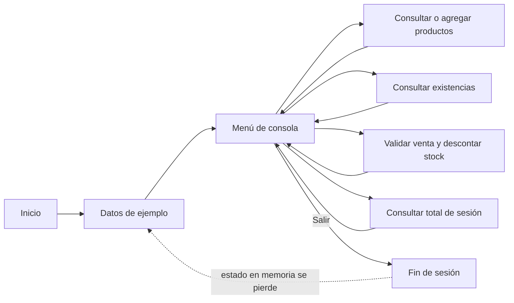

# Arquitectura del programa

## Componentes actuales

La aplicación usa C# y .NET 10. `Program.cs` define los modelos sencillos de producto, cliente y usuario, carga los datos demostrativos, presenta los menús y realiza las operaciones.

| Componente | Ubicación | Responsabilidad actual |
| --- | --- | --- |
| Punto de entrada y menús | `src/NexCodeSales/Program.cs` | Muestra opciones y dirige la interacción de consola |
| Producto | `Program.cs`, clase `Producto` | Mantiene identificador, nombre, categoría, proveedor, precio y stock |
| Cliente | `Program.cs`, clase `Cliente` | Mantiene identificador y datos de contacto de ejemplo |
| Usuario | `Program.cs`, clase `Usuario` | Muestra nombre y rol de los usuarios de ejemplo |
| Colecciones en memoria | `Program.cs` | Conserva productos, clientes, usuarios y totales durante la sesión |
| Solución | `NexCodeSales.slnx` | Agrupa el proyecto ejecutable |

## Diseño de datos relacionado

El modelo relacional de SQL Server del Hito 3 se describe en [modelo-de-datos.md](modelo-de-datos.md). Es un diseño separado del programa actual: no existe acceso a datos, configuración de conexión ni inicialización de SQL Server en el código. El script recibido se conserva como antecedente no canónico en database/legacy/ y no se usa durante la ejecución.

## Flujo de ejecución

## Decisiones y límites

- Se conserva la aplicación de consola recibida como base del trabajo.
- La presentación, las reglas y el almacenamiento están reunidos en un archivo; separar estas responsabilidades es una mejora futura.
- El stock se modifica solo en memoria y solo durante la ejecución actual.
- El código usa `double` para representar precios; antes de ampliar las operaciones conviene acordar una representación decimal y el redondeo.
- Los menús por rol no sustituyen un mecanismo de inicio de sesión ni autorizan operaciones.

## Evolución sugerida

1. Robustecer la lectura de datos y los mensajes de error.
2. Separar menús, reglas de venta y modelos en componentes claros.
3. Diseñar la persistencia y la seguridad como decisiones futuras, con alcance aprobado por el equipo.
4. Agregar pruebas automatizadas para stock, cantidades y totales después de acordar los casos.

